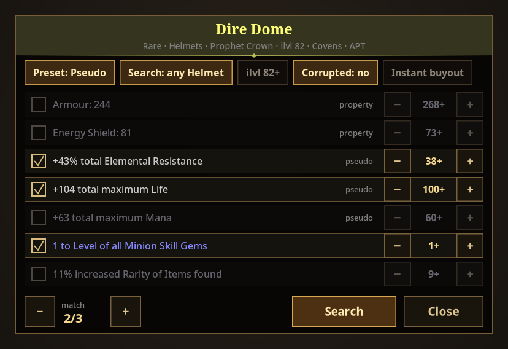
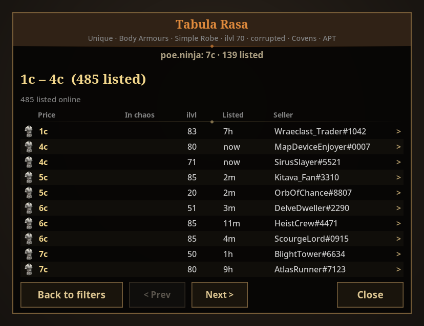
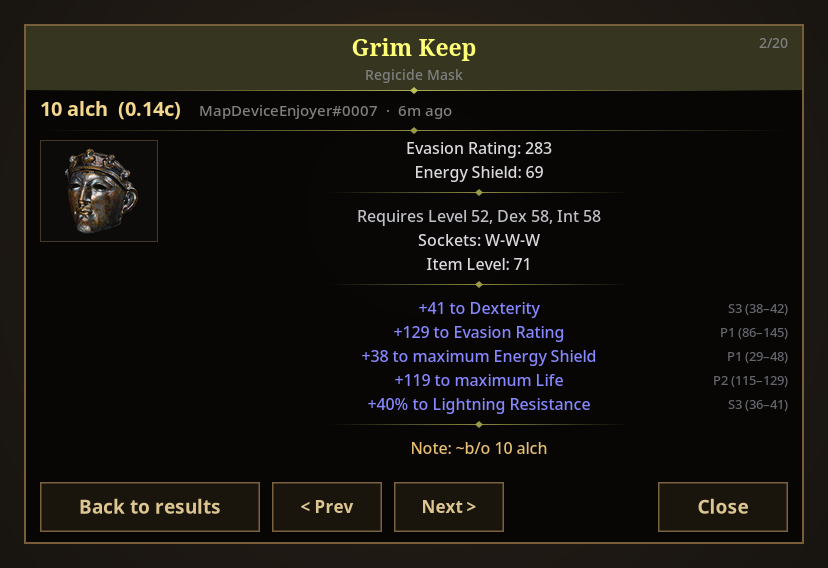
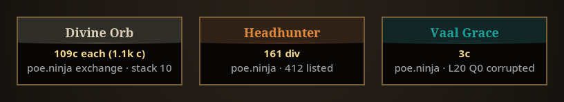

# PoE Price Check for Steam Deck

**Awakened PoE Trade–style price checking for Path of Exile, in Steam Deck Game Mode.**
A [Decky Loader](https://github.com/SteamDeckHomebrew/decky-loader) plugin: hover an item, press one back
button, and a price-check menu opens right over the game. Pick the affixes and filters, search the
official trade site, and browse the cheapest listings, all without leaving PoE.

<p align="center">
  
  
</p>

## Features

- **Works in Game Mode.** No desktop mode, no second device. The menu is drawn over the game and takes touch
  and trackpad input while it is open.
- **Awakened PoE Trade's own search engine.** The plugin runs APT's price-check engine (parser, filter
  presets, roll ranges, pseudo stats, trade queries), so searches match what APT on PC would do.
- **Price-check menu for rares, magic items and uniques:**
  - filter chips: preset (pseudo / base item), any base vs. exact base, item level, links, influences,
    corrupted, instant buyout
  - every affix with its own minimum (− / +, or tap for "any value"), and how many of them must match
  - poe.ninja price for uniques right in the header
- **Results:** price range, the 20 cheapest listings with item icon, price, value in chaos, item level, age
  and seller. Tap a listing to see the full item: properties, affixes with tier and roll range, sockets
  and the seller's note.
- **Price box** for currency, fragments, cards, gems and other items, priced from poe.ninja.
- **Reopen with one press:** copying the same item again brings the menu back with your last choices.
- **Stays up to date:** the panel shows the installed APT version and can update the engine to APT's latest
  release on the Deck itself.
- **Self-contained:** everything it needs, including the Node.js runtime for the engine, is in the plugin.

<p align="center">
  
</p>
<p align="center">
  
  <br><sub>Price box for currency, uniques and gems (example prices)</sub>
</p>

## Fair play

The plugin **never sends input to the game.** It only reads what Path of Exile itself puts on the
clipboard after *you* press the copy key, exactly like Awakened PoE Trade does on PC. There is no
automation: one button press by you, one price check.

## Installation

You need a Steam Deck with [Decky Loader](https://github.com/SteamDeckHomebrew/decky-loader) installed.
Nothing else: the plugin brings its own engine and runtime.

1. Download `decky-poe-price-<version>.zip` from the [latest release](../../releases/latest).
2. In Decky, open **Settings → General** and turn on **Developer mode**.
3. Open **Settings → Developer → Install Plugin from ZIP File** and pick the downloaded zip.
4. *PoE Price Check* appears in the Quick Access Menu (••• button → plug icon).

### Set up the copy button

Path of Exile copies an item's text with **Ctrl+Alt+C** (the advanced copy, which includes affix tiers and
ranges). Bind it to a back button:

1. Steam → Path of Exile → **Controller settings** → **Edit layout** → **Buttons**.
2. Pick a back button (for example **L4**) and add three commands on it: **Control Key**, **Alt Key** and
   **C Key**.
3. Open the gear next to the **C Key** command and set **Fire Start Delay** to about **50 ms**, so Ctrl
   and Alt are already held when C arrives. Without it, Steam may send C first and PoE ignores the copy.

In game, move the cursor over an item with the trackpad and press the button.

## Usage

- **Rare, magic or unique item:** the menu opens top-left. Tap affixes to include them, adjust their
  minimums, switch chips, then **Search**. **Back to filters** changes the search; tap a listing to see it.
  **Close** returns control to the game. The menu also closes by itself after 45 s without input, or as
  soon as you open the Steam or Quick Access menu.
- **Anything else:** a price box appears top-left for a few seconds.
- **Quick Access panel:** the last result and its cheapest listings, recent checks, settings (league,
  instant buyout, what to show over the game, notifications) and the **Price engine** section with the
  APT version and *Check for APT update*.

## How it works

```
your Ctrl+Alt+C ─▶ PoE copies the item ─▶ clipboard watcher (X11/XFixes on PoE's gamescope display)
                                           │
                     poe.ninja prices ◀────┼────▶ Awakened PoE Trade engine (Node.js)
                                           │        parse item, filters, trade query
                                           ▼
                      GTK overlay: menu / price box ◀── pathofexile.com/trade search + listings
```

- **Clipboard:** the plugin finds the running game, reads which X display it draws on (gamescope's
  Xwayland), and watches that display's clipboard. It only reads.
- **Overlay:** two transparent full-screen GTK windows on Steam's display: one gamescope draws over the
  game, one invisible window that receives taps while the menu is open. Details and everything that didn't
  work: [docs/OVERLAY.md](docs/OVERLAY.md).
- **Engine:** Awakened PoE Trade's price-check code, bundled for Node.js with three small stand-ins for its
  app modules; APT itself is not modified. See [engine/README.md](engine/README.md).
- **Prices:** [poe.ninja](https://poe.ninja) for currency, uniques and gems; the official
  [trade site](https://www.pathofexile.com/trade) for searches, with requests spaced to stay inside its
  rate limits.

## Building from source

On a Steam Deck (or any x86-64 Linux) with `git`, Node.js and `pnpm`:

```bash
./scripts/build.sh      # -> out/decky-poe-price/ and out/decky-poe-price-<version>.zip
./scripts/install.sh    # build and install into ~/homebrew/plugins on this Deck (asks for sudo)
```

`build.sh` builds the frontend, fetches Awakened PoE Trade at a pinned release into `engine/vendor` and
bundles its engine, downloads the official Node.js runtime (checksum-verified, cached in `.cache/`), adds
the engine build kit used for on-Deck updates, and zips it all. `--no-node` leaves Node.js out (the plugin
then uses one from the system). To build against a newer APT: `APT_REF=vX.Y.Z engine/fetch-apt.sh`.

## Limits

- Path of Exile 1, English client, PC realm.
- About 140 MB installed (53 MB download), most of it the Node.js runtime.
- Price checking rares is a heuristic, as in any price checker: adjust affixes and minimums when the first
  search looks off.

## Credits and license

- [Awakened PoE Trade](https://github.com/SnosMe/awakened-poe-trade) by Alexander Drozdov (SnosMe),
  MIT license: the price-check engine and its item and stat data.
- [poe.ninja](https://poe.ninja) for prices, [Node.js](https://nodejs.org) (MIT) as the engine runtime.
- [Decky Loader](https://github.com/SteamDeckHomebrew/decky-loader).

This plugin is released under the BSD-3-Clause license ([LICENSE](LICENSE)). It is a fan project, not
affiliated with or endorsed by Grinding Gear Games.
